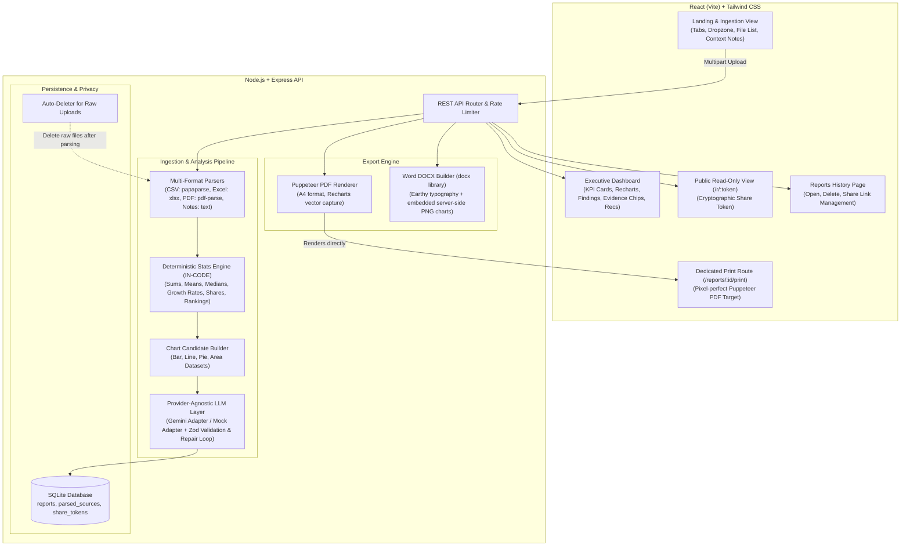

# Ledgerly — AI Business Report Generator

**Ledgerly** transforms raw, unstructured business files (PDF reports, Excel workbooks, CSV exports, meeting notes, operational logs) into structured, decision-ready executive business reports. It is built for non-technical managers and small business owners who require defensible insights traceable directly to source records.

---

## 🎨 Visual Identity: Earthy Brown & Beige Design System

Ledgerly is designed with a warm, grounded aesthetic:
- **Background (warm beige)**: `#F5EFE6`
- **Surface / Cards (warm cream)**: `#FBF7F1`
- **Sand Accent (borders & tabs)**: `#E3D5C0`
- **Primary Brown**: `#6B4F3A`
- **Deep Brown (headings, typography)**: `#3E2C20`
- **Terracotta Accent (CTAs & highlights)**: `#B5651D`
- **Muted Olive (positive growth / success)**: `#7A8450`
- **Clay Red (negative trends / risk warnings)**: `#A8452F`
- **Typography**: Lora & Merriweather (warm serif for headings), DM Sans & Inter (clean sans for body).

---

## 🏗️ Architecture Overview



---

## 🛡️ Anti-Hallucination & Empirical Grounding Guarantee

1. **Deterministic In-Code Arithmetic**:
   - The LLM is **never asked to perform arithmetic**.
   - Totals, averages, standard deviations, period-over-period growth rates, top/bottom N rankings, and categorical percentage shares are calculated purely in code inside `server/src/stats/calculator.ts`.
2. **Precomputed Chart Datasets**:
   - Charts are generated directly from the tabular data and provided as a catalog of available candidate charts. The LLM only cites them; it cannot invent chart points.
3. **Evidence Citations on Every Finding**:
   - Each finding is paired with an `evidence` array containing the source file name, row/table/line location, and exact quotes from the parsed files.
4. **Data Integrity & Risk Audit**:
   - Automated checks compute null rates, duplicate rows, sample size constraints, and scanned PDF detection, computing an objective confidence score (`high` | `medium` | `low`).
5. **Strict Schema Adherence & Repair Loop**:
   - All responses are validated with `zod`. In live LLM mode, if invalid JSON is returned, a repair prompt executes once before falling back gracefully.

---

## 🚀 Quick Start

### 1. Prerequisites
- **Node.js**: v18+ (Node 20+ or 22+ recommended)
- **npm**: v9+

### 2. Install Dependencies
Run the unified install command from the root directory:
```bash
npm run install:all
```
*(This installs root dependencies, server dependencies, and client dependencies).*

### 3. Configure Environment Variables
Copy `.env.example` to `server/.env`:
```bash
cp .env.example server/.env
```

Default configuration runs in **Mock mode** (requires **no API key** and runs completely offline):
```env
PORT=3001
CLIENT_URL=http://localhost:5173
LLM_PROVIDER=mock
GEMINI_API_KEY=
GEMINI_MODEL=gemini-2.5-flash
DATABASE_PATH=./ledgerly.db
MAX_FILE_SIZE=10485760
```

### 4. Run Development Servers
Start both the Express API and the Vite frontend concurrently with a single command:
```bash
npm run dev
```

Open your browser at:
- **Frontend App**: `http://localhost:5173`
- **Backend API**: `http://localhost:3001/api/health`

---

## 🔄 How to Swap the LLM Provider

Ledgerly features a provider-agnostic LLM interface (`LLMProvider`) located in `server/src/llm/types.ts`:

```typescript
export interface LLMProvider {
  name: string;
  generateReport(prompt: string, systemInstruction: string): Promise<ReportJson>;
}
```

### Switching to Google Gemini:
1. Open `server/.env` (or set the environment variable):
   ```env
   LLM_PROVIDER=gemini
   GEMINI_API_KEY=your_google_gemini_api_key_here
   GEMINI_MODEL=gemini-2.5-flash
   ```
2. Restart the server (`npm run dev:server`).

### Adding a Custom Adapter (e.g., Anthropic Claude or OpenAI):
1. Create a new file in `server/src/llm/yourAdapter.ts` implementing the `LLMProvider` interface.
2. In `server/src/llm/index.ts`, add your adapter to the `getLLMProvider()` factory function:
   ```typescript
   if (config.llmProvider === 'your-provider') {
     return new YourCustomAdapter(config.yourApiKey);
   }
   ```

---

## 📁 Sample Datasets Included

Three realistic test datasets are provided in the `/samples` folder:
1. **`samples/sales_data_q1_q3.csv`**:
   - Multi-column sales log across Q1-Q3 2025 (Date, Product Line, Region, Units Sold, Unit Price, Revenue, COGS, Gross Profit, Sales Rep).
2. **`samples/quarterly_financials_2025.xlsx`**:
   - Multi-sheet financial workbook with 3 distinct worksheets:
     - `Profit_and_Loss`: Q1-Q3 line items, gross margin, operating expenses, net income.
     - `Balance_Sheet`: Assets, liabilities, retained earnings.
     - `Department_Expenses`: Headcount and departmental budget spend.
3. **`samples/operations_meeting_notes.txt`**:
   - Realistic leadership review transcript highlighting qualitative context, customer onboarding bottlenecks, and strategic tradeoffs.

You can also click **"Load Sample Dataset"** directly on the landing page for immediate 1-click testing.

---

## 📡 API Specification

| Method | Endpoint | Description |
| :--- | :--- | :--- |
| `POST` | `/api/reports` | Ingest files, pasted text, metadata; begins processing pipeline |
| `GET` | `/api/reports/:id/status` | Poll ingestion & analysis pipeline status |
| `GET` | `/api/reports/:id` | Fetch full report dashboard JSON & computed statistics |
| `DELETE`| `/api/reports/:id` | Delete report and cascade-delete share tokens |
| `GET` | `/api/reports` | List all historical reports with share link status |
| `GET` | `/api/reports/:id/export/pdf` | Download high-fidelity rendered PDF report |
| `GET` | `/api/reports/:id/export/docx`| Download styled Word (.docx) report with embedded PNG charts |
| `POST` | `/api/reports/:id/share` | Generate or retrieve active 128-bit cryptographic share token |
| `DELETE`| `/api/reports/:id/share` | Revoke active public share token |
| `GET` | `/api/shared/:token` | Retrieve read-only public view of report |
| `GET` | `/api/health` | Service health status and LLM provider configuration |

---

## 🧪 Testing

### Backend Unit Tests
Runs the test suite for parsers, statistics computations, and schema validation:
```bash
npm run test
```

### End-to-End Verification
Runs the full end-to-end pipeline (multi-file ingest, status polling, PDF & Word downloads, share token verification and revocation, and Puppeteer screenshot captures):
```bash
node test_e2e.js
```

