# Ledgerly — AI Business Report Generator

**Ledgerly** transforms raw, messy business data (PDF reports, Excel workbooks, CSV exports, operational logs, and meeting notes) into structured, decision-ready executive business reports. Built specifically for non-technical managers and business owners, every finding is backed by deterministic in-code arithmetic and traceable empirical citations.

---

## 🎨 Visual Identity: Earthy Brown & Beige Design System

Ledgerly strictly applies a warm, organic palette across all interfaces, PDF outputs, Word documents, and Recharts visualisations:
- **Background (warm beige)**: `#F5EFE6`
- **Surface / Cards (warm cream)**: `#FBF7F1`
- **Sand Accent (borders & tabs)**: `#E3D5C0`
- **Primary Brown**: `#6B4F3A`
- **Deep Brown (headings, typography)**: `#3E2C20`
- **Terracotta Accent (CTAs & highlights)**: `#B5651D`
- **Muted Olive (positive growth / success)**: `#7A8450`
- **Clay Red (negative trends / risk warnings)**: `#A8452F`
- **Typography**: Lora & Merriweather (warm serif for headings), DM Sans & Inter (clean sans for body). Rounded corners (12 to 16px), soft shadows, and WCAG AA contrast compliance.

---

## 🏗️ Core Architecture & Pipeline

```mermaid
flowchart TD
    subgraph Ingestion ["1. Multi-Input Ingestion"]
        F1["CSV Files (papaparse)"]
        F2["Excel Workbooks (xlsx / SheetJS)"]
        F3["PDF Documents (pdf-parse)"]
        F4["Pasted Notes & Context"]
    end

    subgraph Profiling ["2. In-Code Telemetry Profiler"]
        Types["Type Detection (date, numeric, category, id)"]
        Quality["Quality Score (0-100) & Missing Values"]
        Outliers["IQR Outlier Bounds & Duplicate Checks"]
    end

    subgraph DeterministicEngine ["3. Deterministic Stats (NO Arithmetic by LLM)"]
        Sums["Totals, Means, Medians, Growth Rates"]
        Trends["Time Series Trends (Peak & Trough Markers)"]
        Relations["Pearson Correlation r & Scatter Sets"]
        Dists["Histograms with Outlier Bins & Pareto 80/20"]
    end

    subgraph VisualCatalog ["4. Chart Catalog Engine"]
        Charts["6 to 10 Auto-Generated Visualisations\n(Line, Donut, Horizontal Bar, Scatter, Waterfall, Pareto, Matrix)"]
    end

    subgraph LLM ["5. LLM Synthesis & Validation"]
        PromptEngine["Prompt Version Loader (v1, v2, v3)"]
        GeminiMock["LLM Provider (Gemini 2.5 Flash / Mock Offline Adapter)"]
        ZodValid["Zod Schema Validator + Auto-Repair Loop"]
    end

    subgraph Delivery ["6. Delivery & Export"]
        Dash["Interactive Dashboard (Sticky Nav, Sparklines, Evidence Drawer)"]
        PDF["Puppeteer Headless PDF Export"]
        Word["Word .docx with Embedded Server-Side PNG Charts"]
        Shared["Cryptographic Read-Only Share Link (/r/:token)"]
    end

    Ingestion --> Profiling
    Profiling --> DeterministicEngine
    DeterministicEngine --> VisualCatalog
    VisualCatalog --> LLM
    LLM --> Delivery
```



---

## 🛡️ Anti-Hallucination & Empirical Grounding Guarantee

1. **Deterministic In-Code Arithmetic**:
   - The LLM is **never asked to perform arithmetic**.
   - Totals, averages, standard deviations, period-over-period growth rates, top/bottom N rankings, and categorical percentage shares are calculated purely in code inside `server/src/stats/calculator.ts`.
2. **Precomputed Chart Datasets**:
   - Charts are generated directly from the tabular data and provided as a catalog of available candidate charts. The LLM only writes qualitative captions ("what this shows" and "so what" takeaways); it cannot alter chart data points.
3. **Empirical Evidence Drawer**:
   - Each finding is paired with an `evidence` array containing the source file name, row/table/line location, and exact quotes from the parsed files. Clicking any evidence chip opens an interactive slide-out inspector showing verbatim records.
4. **Data Integrity & Risk Audit**:
   - Automated telemetry checks compute null rates, duplicate rows, sample size constraints, and scanned PDF detection, computing an objective confidence score (`high` | `medium` | `low`) and data quality score (0–100).
5. **Strict Schema Adherence & Repair Loop**:
   - All responses are validated with `zod`. In live LLM mode, if invalid JSON is returned, a repair prompt executes once before falling back gracefully.

---

## 🔬 Prompt Engineering Suite: v1 vs v2 vs v3

Ledgerly includes three evolution tiers of prompt architecture located in `/prompts`:

| Version | Prompt File | Structure | Citations | Arithmetic | Visual Integration |
|---|---|---|---|---|---|
| **v1** | `prompts/v1_basic.txt` | Naive / Unstructured | 0 citations | Relies on LLM arithmetic (hallucination risk) | None |
| **v2** | `prompts/v2_structured.txt` | JSON Schema-bound | Document level | Basic string references | Generic recommendations |
| **v3** | `prompts/v3_production.txt` *(Default)* | Multi-Stage Certified | File + Row Index + Quote | 100% In-Code Deterministic Engine | 6-10 Curated Charts with "What it shows" & "So what" |

### Multi-Prompt Comparison Sandbox (`/compare`)
Navigate to `/compare` in the navigation bar to paste any CSV or tabular dataset and run all three prompts side-by-side, evaluating output fidelity, citation accuracy, and hallucination resistance in real-time.

---

## 📁 Sample Datasets Included (`/samples`)

Test datasets are included in the repository:
- **`samples/sales.csv`**: ~500 rows of transactional sales data across multiple regions, categories, margins, and customer satisfaction scores.
- **`samples/finance.xlsx`**: Multi-sheet financial model containing `Income_Statement` (4 quarters of revenue, COGS, OPEX, margins) and `Department_Budgets`.
- **`samples/report.pdf`**: Digital corporate report featuring narrative sections and structured revenue tables.
- **`samples/empty.csv`**: Edge-case test file for 0-row handling.
- **`samples/malformed.csv`**: Edge-case test file with inconsistent column counts and null entries.
- **`samples/image_scanned.pdf`**: Edge-case test file for non-extractable scanned image PDFs.

You can also click **"Load Multi-Source Sample"** directly on the landing page for immediate 1-click testing.

---

## 🚀 Quick Start (Local Development)

### 1. Prerequisites
- **Node.js**: v18+ (Node 20+ or 22+ recommended)
- **npm**: v9+

### 2. Install Dependencies
```bash
npm run install:all
```

### 3. Configure Environment Variables
Copy `.env.example` to `server/.env`:
```bash
cp .env.example server/.env
```

Default configuration runs in **Mock mode** (requires **no API key** and runs completely offline):
```env
PORT=3001
CLIENT_URL=http://localhost:5173
LLM_PROVIDER=mock
GEMINI_API_KEY=
GEMINI_MODEL=gemini-2.5-flash
DATABASE_PATH=./ledgerly.db
MAX_FILE_SIZE=10485760
```

### 4. Run Development Servers
```bash
npm run dev
```

Open your browser:
- **Frontend App**: `http://localhost:5173`
- **Compare Prompts**: `http://localhost:5173/compare`
- **Backend API**: `http://localhost:3001/api/health`

---

## 🔄 How to Swap the LLM Provider

Ledgerly features a provider-agnostic LLM interface (`LLMProvider`) located in `server/src/llm/types.ts`.

### Switching to Google Gemini:
1. Open `server/.env` (or set Render environment variables):
   ```env
   LLM_PROVIDER=gemini
   GEMINI_API_KEY=your_google_gemini_api_key_here
   GEMINI_MODEL=gemini-2.5-flash
   ```
2. Restart the server (`npm run dev:server`).

### Adding a Custom Adapter (e.g., Anthropic Claude or OpenAI):
1. Create a new file in `server/src/llm/yourAdapter.ts` implementing the `LLMProvider` interface.
2. In `server/src/llm/index.ts`, add your adapter to the `getLLMProvider()` factory function:
   ```typescript
   if (config.llmProvider === 'your-provider') {
     return new YourCustomAdapter(config.yourApiKey);
   }
   ```

---

## ☁️ Step-by-Step Deployment on Render

Ledgerly is containerized via a production `Dockerfile` with bundled Chromium, fonts, and Node.js v22.

### Step 1: Connect GitHub Repository
1. Log into your [Render Dashboard](https://dashboard.render.com).
2. Click **New +** > **Web Service**.
3. Select your repository: `https://github.com/janmesh16/Business-Report-Generator-`.

### Step 2: Service Configuration
- **Name**: `ledgerly-business-report`
- **Region**: Any (e.g., Oregon or Frankfurt)
- **Branch**: `main`
- **Runtime**: **Docker** (Render detects the root `Dockerfile` automatically)
- **Instance Type**: **Free ($0/month)**

### Step 3: Persistent Storage on Free Tier
> **Note on Render Free Tier Disks:** Render disables paid persistent disks on the $0/month free tier. Ledgerly is pre-architected to store its SQLite database in `/app/data/ledgerly.db` inside the container filesystem. You do **NOT** need to attach a paid disk. If you upgrade to a paid Render plan, you can mount a persistent disk at `/app/data`.

### Step 4: Environment Variables (Copy & Paste)
Under the **Environment Variables** section on Render, add:

```env
PORT=3001
NODE_ENV=production
CLIENT_URL=https://ledgerly-business-report.onrender.com
LLM_PROVIDER=mock
GEMINI_MODEL=gemini-2.5-flash
GEMINI_API_KEY=
DATABASE_PATH=/app/data/ledgerly.db
PUPPETEER_SKIP_CHROMIUM_DOWNLOAD=true
PUPPETEER_EXECUTABLE_PATH=/usr/bin/chromium
```
*(When you have a Gemini API key, change `LLM_PROVIDER=gemini` and paste your key in `GEMINI_API_KEY`).*

### Step 5: Advanced Settings
- **Health Check Path**: `/api/health`
- **Docker Build Context Directory**: `.`

Click **Create Web Service** / **Deploy web service**. Render will build the container, install system Chromium dependencies, compile TypeScript, and serve the application live!

---

## 🧪 Automated Testing & Verification

### Unit & Statistical Suite
```bash
npm run test
```
Runs 9 comprehensive test suites verifying math calculations, IQR outlier detection, Pearson correlation $r$, Pareto distributions, and Zod schema validations. Full report available in [`/tests/report.md`](tests/report.md).

### End-to-End Browser & Export Verification
```bash
node test_e2e.js
```
Runs full ingestion of CSV, Excel, and PDF files, downloads PDF and Word `.docx` documents, generates and revokes share tokens, and captures desktop and mobile viewport screenshots.

---

## 🎬 3-Minute Demo Script

1. **Step 1: Upload & Multi-Input Ingestion**
   - Open `http://localhost:5173`.
   - Click "Load Multi-Source Sample" (or drag `sales.csv` and `finance.xlsx`).
   - Add report context: "Should we prioritize Enterprise or SMB sales for Q3?".
2. **Step 2: Pre-Flight Data Preview**
   - Click "Preview Data & Telemetry" to inspect row counts, detected column types, and null rates before generation.
3. **Step 3: Generate Report**
   - Click "Generate Business Report". Watch the 4 live pipeline stages: `Parsing` > `Profiling data` > `Building charts` > `Writing report`.
4. **Step 4: Explore the Executive Dashboard**
   - Review headline KPIs with interactive sparklines.
   - Inspect key findings. Click an **Evidence Chip** to open the slide-out **Evidence Drawer** showing the exact source file, line index, and raw table row.
   - Scroll through Section 6 "Visual Analysis" showing 6–10 automatically constructed charts.
5. **Step 5: Multi-Format Delivery**
   - Click "Download PDF" (pixel-perfect Puppeteer print).
   - Click "Download Word" (opens `.docx` with embedded PNG chart snapshots and tables).
   - Click "Share" to copy the `/r/:token` link. Open in an incognito window to view the public read-only report.
6. **Step 6: Compare Prompt Architectures**
   - Click "Compare" in the top navigation.
   - Click "Run 3-Way Comparison" to inspect the differences between `v1` (Naive), `v2` (Structured), and `v3` (Production).

---

## ⚠️ Known Limitations & Edge Cases

- **Scanned Image PDFs**: Scanned PDFs without an embedded text layer will trigger a low data quality warning with a recommendation to upload OCR-processed text or CSV tables.
- **Very Large Spreadsheets (>100,000 rows)**: Processed in memory; memory limits may require chunking on 512MB RAM free-tier instances.
- **Offline Mock Mode**: When `LLM_PROVIDER=mock`, the application returns high-fidelity deterministic responses without querying external AI APIs.
