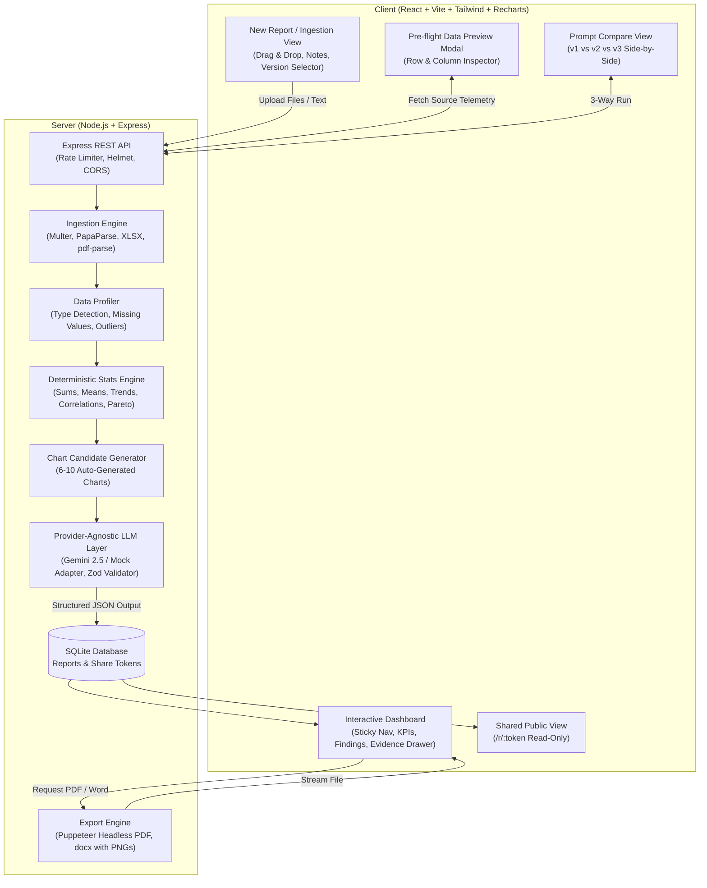
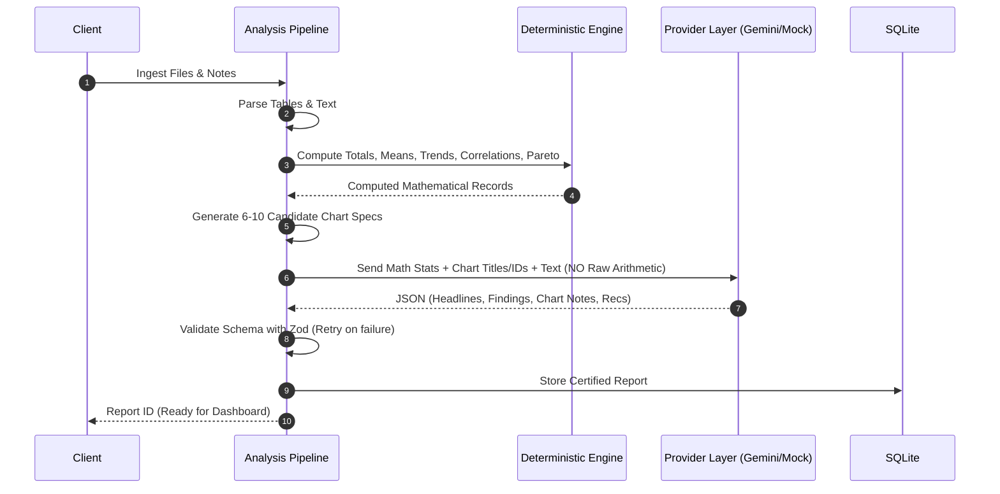
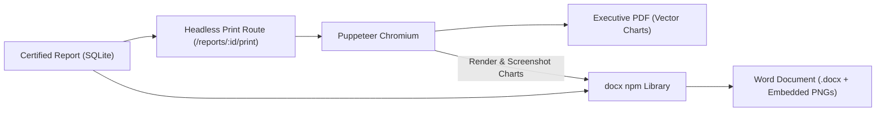

# Ledgerly System Architecture

Ledgerly is an AI-powered business report generation engine designed to transform messy, unorganized business data (sales exports, financial workbooks, operational PDFs, meeting notes) into executive-grade, decision-ready reports with guaranteed numerical accuracy.

---

## 1. End-to-End System Architecture

---

## 2. Ingestion & Pre-flight Profiling

Ledgerly handles multi-source, heterogeneous data uploads:
1. **CSV Files (`.csv`)**: Parsed via PapaParse with automatic delimiter inference, type coercion, and empty row stripping.
2. **Excel Workbooks (`.xlsx`, `.xls`)**: Parsed with SheetJS. Users can choose specific sheets (e.g., `Income_Statement` vs `Department_Budgets`).
3. **PDF Documents (`.pdf`)**: Extracted via `pdf-parse` into clean section narratives and tabular text with page index markers.
4. **Pasted Notes**: Handled as contextual guidance or unstructured qualitative observations.

### Pre-flight Telemetry Profiler
Before running calculations, the profiler inspects every column:
- **Type Classification**: `numeric`, `category`, `date`, `id`, `text`.
- **Integrity Metrics**: Null percentage, unique cardinality, IQR outlier boundaries ($Q_1 - 1.5 \times \text{IQR}$, $Q_3 + 1.5 \times \text{IQR}$).
- **Composite Quality Score**: 0 to 100 based on completeness, uniqueness, and format cleanliness.

---

## 3. Strict Anti-Hallucination & Statistical Engine

> **Core Axiom:** Never ask the LLM to perform arithmetic or calculate statistics. All calculations are executed deterministically in TypeScript.

### Computed Statistical Catalog
- **Aggregations**: Sum, Mean, Median, Min, Max, Standard Deviation.
- **Time-Series Dynamics**: Period-over-period growth rates, trend direction (`up`, `down`, `flat`), peak and trough point identification.
- **Relational Analysis**: Pearson correlation coefficient $r$ across numeric pairs.
- **Distributions**: Binned histograms with IQR outlier tags, Pareto cumulative 80/20 distribution curves.
- **KPI Sparklines**: Array of sequential numeric values to drive mini trendlines in the dashboard.

---

## 4. Chart Candidate Catalog Engine

The system automatically generates **6 to 10 rich charts** derived entirely from data:

| Chart Type | Trigger Condition | Visual Characteristics |
|---|---|---|
| **Line / Area Chart** | Date column + Numeric column | Chronological trend, monthly/weekly grouping, marked peak & trough dots |
| **Horizontal Bar** | Category + Numeric column | Top 10 sorted segments with formatted values |
| **Donut Chart** | Category $\le 6$ unique values | Market share percentages with clean center callout |
| **Grouped / Stacked Bar** | 2 Categories + 1 Numeric | Cross-dimensional performance (e.g. Region by Product) |
| **Scatter Plot** | 2 Numeric columns ($N \ge 10$) | Plotted points with Pearson correlation $r$ and regression line |
| **Histogram** | Numeric distribution ($N \ge 15$) | Binned frequency distribution with flagged outlier buckets |
| **Waterfall Variance** | Sequential periods | Period-over-period delta variances (gains in olive, drops in clay) |
| **Pareto Chart** | Category + Metric | Volume bars paired with cumulative percentage curve |
| **Data Quality Bar** | Any dataset | Visual breakdown of valid rows, nulls, and outliers |
| **Process / Matrix** | Qualitative / Status notes | Flow diagram or 2x2 Risk vs Impact grid |

---

## 5. Prompt Engineering Architecture

Ledgerly provides three evolution levels of prompt architecture:

1. **`v1_basic.txt`**: Naive prompt asking for summary and findings. Lacks schema enforcement, resulting in inconsistent JSON and ungrounded statements.
2. **`v2_structured.txt`**: Enforces a strict JSON structure with KPI cards and impact levels. Improves formatting but lacks granular source anchors.
3. **`v3_production.txt` (Default)**: Multi-stage prompt enforcing:
   - Grounding on in-code computed statistics only.
   - Empirical citations (`source`, `location`, `quote`).
   - Chart curation linking finding IDs to specific candidate chart IDs.
   - Dual-layer takeaways for each visual: "What this shows" and "So what".
   - Structured recommendations prioritized by impact.

---

## 6. Export Pipeline

- **Puppeteer PDF**: Loads the dedicated print view with matching screen styles, CSS variables, and zero chart degradation.
- **Word Document (.docx)**: Puppeteer captures high-resolution 2x PNG snapshots of all dashboard charts, embedding them natively alongside styled tables and bulleted recommendations.

---

## 7. Storage, Security & Deployment

- **Database**: Single-file SQLite via Node's native `node:sqlite` (`DatabaseSync`), requiring zero external native compilation.
- **Privacy Guarantee**: Uploaded files in `/tmp/uploads` are deleted immediately after parsing. Only derived mathematical aggregates and report text are persisted.
- **Sharing**: Read-only public share links (`/r/:token`) protected by cryptographic tokens that can be revoked or regenerated at any time.
- **Containerization**: Multi-stage `Dockerfile` with bundled Chromium, fonts, and production build optimization. Ready for one-click deployment on Render, Fly.io, or Railway.
